<div align="center">

# Commitcade

**Your commits. A close encounter.**

Turn a GitHub contribution calendar into an animated UFO scene: a flying saucer, a glowing tractor beam, and a year's worth of tiny green discoveries.

[Add to your profile](#add-it-to-your-github-profile) · [Local use](#local-use-optional) · [Customize](#cli-reference) · [Contribute](CONTRIBUTING.md)



*Deterministic sample data. Generate your own SVG with a username or try the offline demo.*

</div>

## What you get

- **An animated UFO contribution graph** exported as a self-contained SVG.
- **Three themes:** GitHub Dark, GitHub Light, and Midnight, with a custom beam color, animation speed, labels, and stars.
- **Three UFO personalities:** Classic, Curious, and Collector, with an adjustable beam size.
- **A CLI and GitHub Action** for repeatable generation and profile updates.
- **A JavaScript library** with zero runtime dependencies, deterministic demo data, and a normalized calendar API.

UFO is the implemented graph type. SVG is the implemented export format. Customize it through CLI flags, GitHub Action inputs, or the JavaScript API—no website or server to host. Profile users can use the Action below without installing anything. For local CLI/library use, install directly from this repository; the package is not published to the npm registry.

## Add it to your GitHub profile

No local installation, website, server, or personal access token is needed. Your GitHub username is detected automatically. Setup is two files and one manual run; the workflow then refreshes the graph daily.

**Availability:** `dianbrown/commitcade` must be public before other users can use this workflow from their public profile repositories. A private source repository is not a public Action release.

### 1. Add the workflow

Create or open your public profile repository, **`YOUR_USERNAME/YOUR_USERNAME`**. In GitHub, choose **Add file → Create new file**, name it `.github/workflows/commitcade.yml`, paste the workflow below, and commit it to your default branch. You can also copy [the ready-to-use workflow](examples/profile-workflow.yml). No placeholders need replacing.

```yaml
name: Update contribution graph

on:
  schedule:
    - cron: '17 5 * * *'
  workflow_dispatch:

permissions:
  contents: write

concurrency:
  group: commitcade-profile
  cancel-in-progress: false

jobs:
  generate:
    runs-on: ubuntu-latest
    steps:
      - uses: actions/checkout@v4
        with:
          ref: ${{ github.event.repository.default_branch }}

      - uses: dianbrown/commitcade@main
        with:
          github_user_name: ${{ github.repository_owner }}
          output_dir: assets/commitcade

      - name: Commit changed graphs
        env:
          DEFAULT_BRANCH: ${{ github.event.repository.default_branch }}
        run: |
          git config user.name 'github-actions[bot]'
          git config user.email '41898282+github-actions[bot]@users.noreply.github.com'
          git add -- assets/commitcade/ufo-contribution-graph.svg assets/commitcade/ufo-contribution-graph-dark.svg
          if git diff --cached --quiet -- assets/commitcade/ufo-contribution-graph.svg assets/commitcade/ufo-contribution-graph-dark.svg; then
            echo 'Contribution graphs are unchanged.'
            exit 0
          fi
          git commit -m 'Update Commitcade contribution graphs' -- assets/commitcade/ufo-contribution-graph.svg assets/commitcade/ufo-contribution-graph-dark.svg
          git push origin "HEAD:$DEFAULT_BRANCH"
```

### 2. Run it once

Open **Actions → Update contribution graph → Run workflow**, choose your default branch, and wait for a green check. The run creates the light and dark SVGs in `assets/commitcade/`. GitHub supplies the token automatically; you do not need to create a secret.

### 3. Add the image to your README

Paste the following into the `README.md` at the root of the same profile repository and commit it, or copy [the ready-to-use README snippet](examples/profile-readme.md). The image automatically matches the viewer's light or dark theme. The paths work unchanged for every username and default branch:

```html
<picture>
  <source media="(prefers-color-scheme: dark)" srcset="assets/commitcade/ufo-contribution-graph-dark.svg">
  <source media="(prefers-color-scheme: light)" srcset="assets/commitcade/ufo-contribution-graph.svg">
  
</picture>
```

The action needs no npm install step. It sets up Node 22 and runs the renderer directly. The example uses `@main` while the project is getting started; pin a reviewed commit SHA if you need an immutable action version. Repository rules must permit the workflow's bot to push. If the branch moves during generation, the push can fail; rerun the job rather than force-pushing. Schedules follow UTC and may run later than their scheduled time.

### If the image does not appear

- **Workflow cannot find `dianbrown/commitcade`:** the source repository must be public and your repository must allow the Action.
- **No SVG files yet:** run the workflow manually once and check its result. Adding the README image alone does not generate files.
- **Push is denied:** keep `permissions: contents: write` in the workflow; repository or organization rules must allow the workflow bot to push.
- **A previous image is still visible:** GitHub caches images, so allow time after a successful update.

## Download graphs from a workflow

To generate files without writing a commit, use an artifact:

```yaml
name: Download contribution graphs
on: workflow_dispatch
permissions:
  contents: read
jobs:
  generate:
    runs-on: ubuntu-latest
    steps:
      - uses: actions/checkout@v4
      - uses: dianbrown/commitcade@main
        id: graphs
        with:
          github_user_name: ${{ github.repository_owner }}
          output_dir: generated
      - uses: actions/upload-artifact@v4
        with:
          name: commitcade-graphs
          path: ${{ steps.graphs.outputs.output_dir }}/*.svg
          if-no-files-found: error
```

After the run succeeds, download **commitcade-graphs** from its Actions summary. This repository also includes a runnable [download example](.github/workflows/generate-example.yml) that uses the checked-out local action.

## Action inputs

| Input | Default | Purpose |
| --- | --- | --- |
| `github_user_name` | Required | GitHub username to render |
| `github_token` | `${{ github.token }}` | Token for GitHub's official GraphQL API; set `''` to use the public third-party API |
| `types` | `ufo` | Comma-separated graph type IDs; currently only `ufo` |
| `beam_color` | `'#a3ff12'` | Six-digit hex color; quote it in YAML |
| `beam_size` | `'1'` | Beam size level, from `0.5` to `3`; mostly increases vertical reach |
| `flight_mode` | `classic` | `classic`, `curious`, or `collector` |
| `speed` | `'1'` | Animation speed multiplier, from `0.1` to `5` |
| `show_labels` | `'true'` | `'true'` or `'false'` |
| `show_stars` | `'true'` | `'true'` or `'false'` |
| `output_dir` | `dist` | Subdirectory inside the caller's repository workspace |

Output **`output_dir`** is the relative directory containing the files. For `ufo`, the action writes `ufo-contribution-graph.svg` with `github-light` and `ufo-contribution-graph-dark.svg` with `github-dark`. Existing files with these names are replaced; unrelated files are left alone. The action fetches one calendar and uses it for both variants. Use the CLI for Midnight or static SVGs.

## UFO personalities and beam size

| Flight mode | Behavior |
| --- | --- |
| `classic` (default) | The original wandering flight, mixing nearby clusters with occasional longer trips |
| `curious` | Shorter exploratory hops, slower cruising, and occasional beam-off inspection pauses with a look-around tilt |
| `collector` | Seeks the remaining cluster with the most occupied squares inside the beam; prefers nearby clusters when counts tie |

Set the personality and beam size independently. For example, add these inputs to your profile workflow's Commitcade step:

```yaml
flight_mode: curious
beam_size: '2'
```

`beam_size` accepts numbers from `0.5` to `3`, including fractional values. It is a gentle size control, not a direct width multiplier. `1` keeps the original 54-pixel-wide cone. `2` gives roughly 25% more vertical reach and just 15% more width (62.1 pixels); `3` gives roughly 50% more reach and 30% more width (70.2 pixels). Vertical reach is limited near the top of the graph to keep the UFO visible. The saucer itself stays the same size.

Only occupied squares whose centers fall inside the cone are collected. A larger beam can capture more days per stop, depending on nearby activity; it does not change contribution counts or invent activity. Each square is collected at most once per loop, and the beam stays open until the whole cluster has lifted. `speed` still adjusts the overall animation speed independently of the personality.

The [manual download workflow](.github/workflows/generate-example.yml) also offers personality and beam-size choices in its Run workflow form. No website is needed.

## Local use (optional)

Use **Node.js 22.12 or newer** and npm. Clone the source:

```sh
git clone https://github.com/dianbrown/commitcade.git
cd commitcade
npm ci
node cli/index.js --demo --output generated/demo.svg
```

Open `generated/demo.svg` in your browser to watch the animation. The demo works without network requests. To generate your own graph:

```sh
node cli/index.js --username octocat --output generated/octocat.svg
```

To install the CLI directly from this Git repository:

```sh
npm install --global git+https://github.com/dianbrown/commitcade.git
commitcade --demo --output demo.svg
```

You can also run `npm link` inside the checkout to make its `commitcade` command available locally. Neither approach requires an npm registry release of Commitcade.

## CLI reference

```sh
commitcade --username octocat --theme midnight --beam-color '#80ffdb' --speed 1.5 --output generated/octocat.svg
commitcade --demo --theme github-light --no-stars --no-labels --static --output generated/static.svg
commitcade --username octocat --flight-mode curious --beam-size 2 --output generated/curious.svg
commitcade --demo --flight-mode collector --beam-size 3 --output generated/collector.svg
commitcade --help
```

In a source checkout, replace `commitcade` with `node cli/index.js`.

| Flag | Default | Purpose |
| --- | --- | --- |
| `--username NAME` | — | Fetch a GitHub user's contribution calendar |
| `--demo` | Off | Use deterministic sample data; cannot be combined with `--username` |
| `--type TYPE` | `ufo` | Graph type ID |
| `--theme THEME` | `github-dark` | `github-dark`, `github-light`, or `midnight` |
| `--beam-color HEX` | `#a3ff12` | Six-digit hex beam color |
| `--beam-size NUMBER` | `1` | Beam size level, `0.5`–`3`; mostly increases vertical reach |
| `--flight-mode MODE` | `classic` | `classic`, `curious`, or `collector` |
| `--speed NUMBER` | `1` | Animation speed multiplier, `0.1`–`5` |
| `--output PATH` | `dist/ufo-contribution-graph.svg` | SVG file; parent directories are created |
| `--no-labels` | Off | Hide calendar labels |
| `--no-stars` | Off | Hide background stars |
| `--static` | Off | Disable animation |
| `--help`, `-h` | — | Print usage |

The CLI replaces the chosen output file, exits with status `1` on failure, and times out contribution requests after 30 seconds. Configure **`GITHUB_TOKEN` in your environment** to use the official API. There is intentionally no token command-line flag. Without a token, it uses the public data provider; an invalid configured token produces an error rather than silently changing providers.

## JavaScript API

Install the repository in your project:

```sh
npm install git+https://github.com/dianbrown/commitcade.git
```

```js
import { writeFile } from 'node:fs/promises';
import { createDemoCalendar, fetchGitHubCalendar, renderGraph, themes, graphTypes, flightModes } from 'commitcade';

const calendar = createDemoCalendar(42);
// Or, in Node.js:
// const calendar = await fetchGitHubCalendar('octocat', {
//   token: process.env.GITHUB_TOKEN,
//   signal: AbortSignal.timeout(30_000),
// });

const svg = renderGraph(calendar, {
  type: 'ufo',
  theme: 'github-dark',
  beamColor: '#a3ff12',
  beamSize: 2,
  flightMode: 'curious',
  speed: 1,
  showLabels: true,
  showStars: true,
  animation: true,
});
await writeFile('contributions.svg', svg);

console.log(Object.keys(themes));
console.log(graphTypes); // [{ id, name, description }]
console.log(flightModes); // ['classic', 'curious', 'collector']
```

The package entry point is `src/core/index.js`. `renderGraph(calendar, options)` synchronously returns an SVG string. `createDemoCalendar(seed = 42)` returns repeatable sample data. `fetchGitHubCalendar(username, { token, signal, fetchImpl } = {})` asynchronously returns a normalized calendar; `fetchImpl` lets tests inject a fetch implementation. The normalized shape is:

```js
{
  username: 'octocat',
  totalContributions: 3,
  weeks: [{
    contributionDays: [{
      date: '2026-01-04',
      contributionCount: 3,
      contributionLevel: 1, // integer 0–4
      weekday: 0,          // Sunday = 0, Saturday = 6
    }],
  }],
}
```

Pass `animation: false` for a static graph. The renderer's type registry lives in `src/core/registry.js`; see [Contributing](CONTRIBUTING.md#add-a-graph-type) for adding a renderer and registering its metadata. The registry is a source extension point, not a promise of additional installed graph types.

## Data, privacy, and browser support

### The UFO encounter

The compact saucer wanders around the calendar on curved flights, banking into turns and gently rocking as it hovers. It approaches with its beam retracted, settles over a target, and opens a green cone. Occupied squares inside the cone rise into the ship together, then the beam retracts before the next flight. Nearby discoveries are mixed with occasional longer excursions; collection follows the beam's footprint.

Each loop visits a selection of contribution clusters and gently restores collected squares before repeating. The route is seeded from the calendar, so it looks random while identical input produces identical SVGs. Empty calendars get a quiet patrol without invented contributions. Reduced-motion preferences and static exports preserve the complete calendar.

### Contribution sources

Demo data stays local. Without a token, contribution lookups use **[github-contributions-api.jogruber.de](https://github-contributions-api.jogruber.de/)**, a third-party public contribution service. That provider receives the username and ordinary request metadata, including the requesting machine's IP address. Availability, caching, and rate limits are controlled by the provider.

The CLI and action can send a token directly to `https://api.github.com/graphql` for GitHub's official contribution calendar. Token-bearing requests are not sent to the third-party provider. Use environment variables or GitHub Actions secrets. Visible contribution totals depend on the account's contribution visibility and the data provider; this tool does not bypass privacy settings.

SVG files contain the rendered calendar and do not fetch data themselves. Modern browsers support the animation; image viewers and platforms may render only a still frame. Use `--static` when motion is unwanted. Embedding the SVG as an image does not require JavaScript on the page.

## Development

```sh
npm ci           # Install from the lockfile (no dependencies required)
npm test         # Node test suite
npm run check    # Same validation used by CI
npm run demo     # Regenerate assets/demo.svg
```

CLI tests run against demo data with network access disabled. Core rendering and data-provider tests use local fixtures. Changes are checked by the [CI workflow](.github/workflows/ci.yml). Read [CONTRIBUTING.md](CONTRIBUTING.md) before adding a graph type or changing the public API.

## Credits and license

Inspired by the playful profile animations in [abozanona/pacman-contribution-graph](https://github.com/abozanona/pacman-contribution-graph). Commitcade is an original implementation; no code from that project was copied.

[MIT](LICENSE) · Copyright © 2026 Commitcade contributors.
